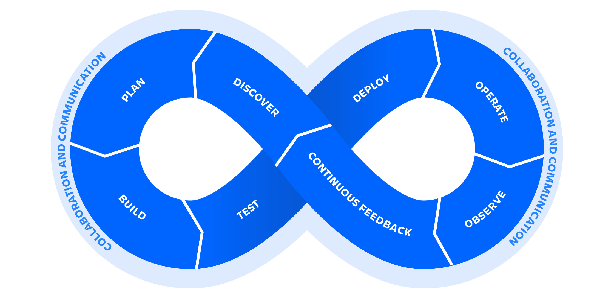

import HomepageFeatures from '@site/src/components/HomepageFeatures';

## Для кого этот сайт

Этот сайт — это тщательно подобранный DevOps-блокнот для тех, кому нужно больше, чем просто определения. Он объединяет обзоры тем, команды, диаграммы, примеры манифестов и небольшие запускаемые примеры, чтобы вы могли перейти от концепции к практике, не переключаясь между десятью разными вкладками.

:::tip Как использовать этот Сайт
Если вы новичок, начните с `Linux`, `Networking`, `Git`, `Docker` и `Kubernetes`. Если вы уже поставляете ПО, переходите сразу к `Terraform`, `GitHub Actions`, `Prometheus`, `GitOps` или `DevSecOps`.
:::

## Что такое DevOps на практике

DevOps — это не один инструмент и не должность. Это способ разработки и эксплуатации ПО, который делает упор на быструю обратную связь, автоматизацию, надёжность и общую ответственность за работу разработки и эксплуатации.

На практике это обычно означает:

- выпускать изменения небольшими, более безопасными партиями
- использовать контроль версий как для кода, так и для инфраструктуры
- автоматизировать этапы сборки, тестирования, развёртывания и проверки
- относиться к наблюдаемости и безопасности как к части поставки, а не как к чему-то второстепенному

## Жизненный цикл DevOps

Бесконечная петля — полезная ментальная модель, но главное здесь — непрерывная обратная связь:

1. Спланируйте изменение и определите ожидаемый результат.
2. Собирайте и тестируйте воспроизводимым способом.
3. Выпускайте с достаточной уверенностью, видимостью и возможностями отката.
4. Эксплуатируйте, наблюдайте и возвращайте полученные знания в следующую итерацию.

## Замечания о качестве

- Основной контент лендинга и отдельные популярные документы были сверены с официальной документацией в апреле 2026 года.
- CLI, API и настройки по умолчанию у вендоров часто меняются. Проверяйте зависящие от версии команды перед использованием в продакшене.
- Если вы нашли битую ссылку, устаревший пример или вводящее в заблуждение объяснение, откройте issue или отправьте pull request.

<HomepageFeatures />

> Привет, я создал этот репозиторий, чтобы хранить своё обучение, заметки и код по различным инструментам DevOps в одном месте. Сейчас он каждый день помогает тысячам учащихся, практиков и профессионалов в их пути в DevOps. Удачи вам в освоении DevOps!
>
> [Pradumna Saraf](https://x.com/pradumna_Saraf)

> Привет, я  Алексей Шило перевел этот текст на русский.
> Я обучаю своей специальности с 2020 года.
> Если ты хочешь попасть на обучение напиши мне в телеграм
> [Алексей Шило telegram](https://t.me/alexpricker)
> [Алексей Шило linkedin](https://www.linkedin.com/in/alexshilo/)

## Рекомендуемые точки старта

- [Docker](/docker)
- [Kubernetes](/kubernetes)
- [GitHub Actions](/github-actions)
- [Terraform](/terraform)
- [Вопросы и ответы](/qna)
